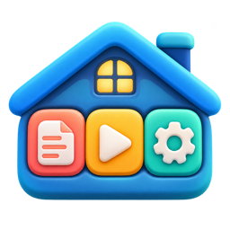

# Jupiter: a self-hosted household platform

I'm Travis Hill, a product marketer with about 25 years across product marketing, content, lifecycle and customer experience. Jupiter is my personal build project: a set of small, self-hosted apps that help a family save, find and review its documents, records and family video, with no cloud AI touching private records.

I run it the way I'd run a product. Every app starts from a stated user need, ships in small releases with tests and rollback, and has written principles for what it will never do. The code in this repo is real, working software running on my home server, sanitized for public viewing.

## The apps

| | App | What it does | Status |
|---|---|---|---|
|  | [**Document Desk**](document-desk/) | Household document intake: drag in PDFs, photos, Office files or email, local OCR, review, template-based filing, per-person private and shared access | Release 2 |
|  | [**Family Media Library**](design-docs/family-media-library.md) | A catalog for the family's own video: dance, sports, workouts and events, with people, multi-angle links and a "best version" flag | Design |
|  | [**Development Discovery**](design-docs/development-discovery-phase-1-spec.md) | Describe a need in plain language, find applications, components and implementations on GitHub, and see evidence for each requirement | Phase 1 spec |
| | [**Family Drive Catalog**](family-drive-catalog/) | A read-only Mac tool that inventories external drives, with optional SHA-256 hashing to find exact duplicates across volumes | First version |

## Principles that shape every release

- **Easy to save and easy to retrieve.** If it isn't both, it fails.
- **Easy upkeep.** One dependable update path, persistent data and backups. Earlier attempts with Drupal, MediaWiki and Joomla failed because maintaining them became a job.
- **Built for the family, not just the admin.** Warm, calm, rounded, Apple-like interfaces.
- **Understand first, organize second, change files only after review.** Originals are preserved, cleanup goes to a recoverable quarantine, and nothing is deleted automatically.
- **Automation assists; people approve.** Uncertain or consequential decisions go to a person.
- **Ownership, access, assignment and approval are four separate things.** Assigning someone a review task never grants access to private material.
- **Borrow before building.** Reuse fields, formats, patterns and suitably licensed code first.

## Design documents

These show how I scope, set guardrails and write requirements before code:

- [Development Discovery, Phase 1 spec](design-docs/development-discovery-phase-1-spec.md): evidence states, result roles, acceptance briefs and honest failure cases
- [Family Media Library direction](design-docs/family-media-library.md): defining the record, naming conventions and privacy safeguards before writing code
- [Model data-handling policy](design-docs/model-data-handling-policy.md): which data classes may ever reach a hosted AI model, and how that is enforced server-side

## Engineering notes

- **Stack:** Python (Flask), SQLite, vanilla JavaScript, Docker on Unraid, Tesseract for local OCR
- **Security:** salted PBKDF2 or scrypt password hashing, hashed revocable sessions, CSRF and same-origin checks, login throttling, read-only API keys kept server-side
- **Releases:** installers back up data, verify startup and restore the previous container automatically on failure
- **Testing:** each app ships with automated tests for authentication, permissions, data preservation and file handling

## About this repo

Network addresses, account names, household members and real documents have been replaced with placeholders or synthetic test data. Install scripts assume an Unraid server and reference `<server-ip>` where a LAN address was.
